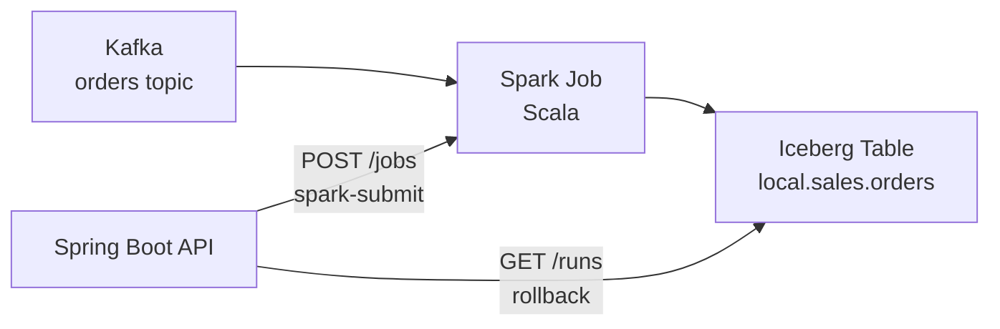

# Order Ingestion

## 1. Overview

The project is a Spring Boot application that launches a Spark job.
The job reads order events from the Kafka `orders` topic, performs simple transformations, adds metadata columns, and loads the data into an Apache Iceberg table.

## 2. How to Run

1. Start the environment

   `docker compose up -d --build`

2. Load the sample data into Kafka

   `.\scripts\load-samples.ps1`

3. Run the ingestion job

   `POST http://localhost:8080/jobs`

4. View run history

   `GET http://localhost:8080/runs`

5. Roll back to a specific Iceberg snapshot if needed

   `POST http://localhost:8080/runs/rollback/{snapshotId}`

## 3. Design

Spring Boot launches the Spark job as a separate application, while Spark reads from Kafka and writes the processed orders to Iceberg.

I added `kafka_partition` and `kafka_offset` to the Iceberg table to make it easier to trace each row back to its source message in Kafka.

## 4. Delta Loading

the first run starts from Kafka 'earliest' .

After run is successful, the next Kafka offsets are saved in the iceberg snapshot metadata.

The next run starts from those offsets, this prevents loading the same messages again so no duplicate data.

if there are no new messages, the job exit without writing anything.  

## 5. API

### `POST /jobs`
Runs the Spark ingestion job.

### `GET /runs`
Returns the successful ingestion runs with:

- `runTs`
- `snapshotId`
- `commitTime`
- `rowsAdded`

### `POST /runs/rollback/{snapshotId}`
Rollback the Iceberg table to the selected snapshot.

## 6. Production / Assumptions

### Assumptions

- The Spark job runs synchronously using 'local[*]'.
- Malformed records are skipped.
- Iceberg metadata is used for run history and kafka offsets
- Rollback changes the iceberg table state only and does not rewind kafka offsets.

### Production 

For production:
- I would use object storage like s3 instead of the local filesystem 
- use a DLQ for malformed records
- run spark job on a cluster 
- run jobs async through a scheduler or orchestrator

All requested requirements are implemented.
